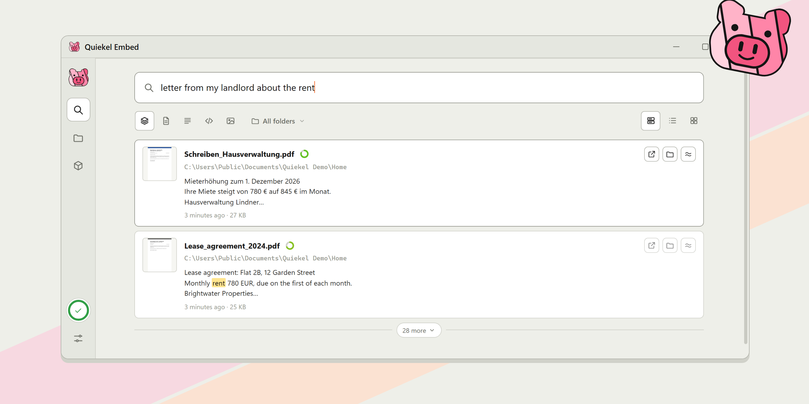
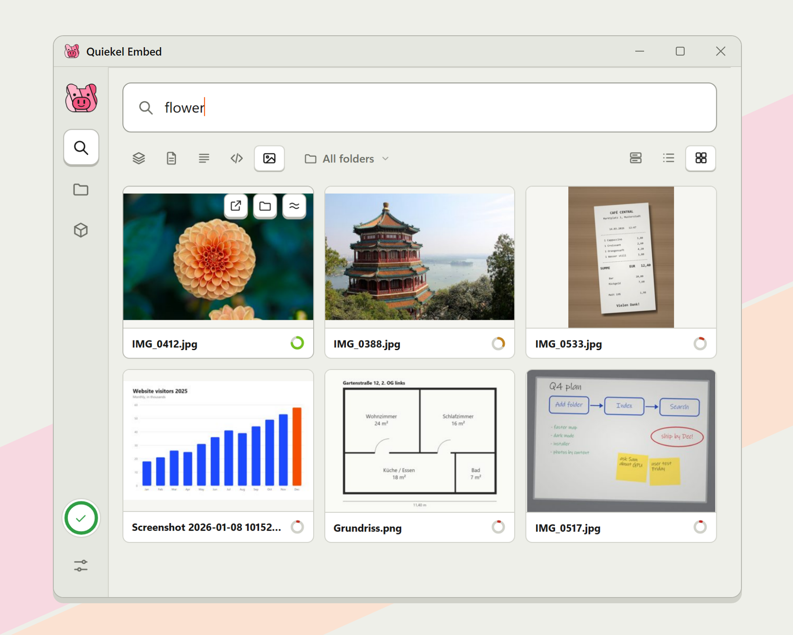
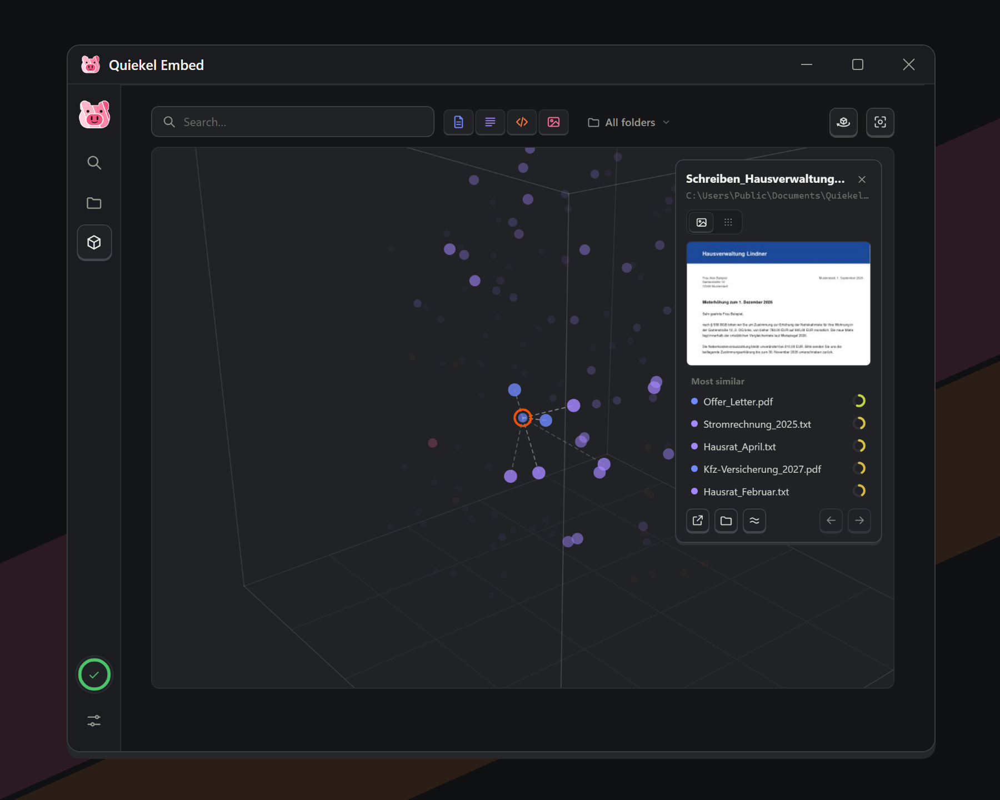

<p align="center">
  <picture>
    <source media="(prefers-color-scheme: dark)" srcset="src/quiekel_embed/static/pig-dark.svg">
    
  </picture>
</p>

<h1 align="center">Quiekel Embed</h1>

<p align="center">Search your files by what's in them. Locally, on Windows.</p>

<picture>
  <source media="(prefers-color-scheme: dark)" srcset="docs/screenshots/hero-dark.png">
  
</picture>

- Search by meaning and by keywords, in 100+ languages.
- Documents, emails with attachments, text and code, photos by what they show, files in archives.
- Runs on the graphics card or the processor. Files, index and searches stay on the PC.
- Indexes in the background: slows down for busy apps, waits while a game runs.

| Photos by what they show | Similar files on a map |
|---|---|
|  |  |

## Install

Windows 10 or 11, 64-bit. In PowerShell:

```powershell
irm https://github.com/catdrinkmonster/quiekel-embed/raw/main/install.ps1 | iex
```

In Command Prompt:

```bat
powershell -ExecutionPolicy Bypass -c "irm https://github.com/catdrinkmonster/quiekel-embed/raw/main/install.ps1 | iex"
```

Installs uv, the app and a desktop shortcut (about 300 MB; the model follows on first start, 0.5
to 0.9 GB). Without Git, the app gets its own copy (MinGit) in its folder. No administrator rights
needed: run it in a normal PowerShell window, and again to update. macOS and Linux are not
supported.

The model runs with ONNX Runtime, in a process of its own at below-normal priority. The app looks
at the PC once and picks a setup:

| PC | The model runs on | Memory |
|---|---|---|
| A graphics card with 3 GB of its own or more | the graphics card (DirectML) | 0.6 GB, and 1.5 to 2.7 GB of the card's |
| Built-in graphics or a smaller card, and 16 GB or more | the graphics, with the PC's memory; unloaded when not in use | about 3 GB |
| Otherwise | the processor, half the cores (at most 8) | at most 1.5 GB |
| Less than 12 GB, or fewer than 4 cores | the processor, at most 2 cores; unloaded when not in use | at most 1 GB |

Windows holds the model to that memory. If the graphics card fails, the processor takes over.

<details>
<summary>Install by hand, or uninstall</summary>

With [uv](https://docs.astral.sh/uv/) and [Git](https://git-scm.com/):

```powershell
git clone https://github.com/catdrinkmonster/quiekel-embed "$env:LOCALAPPDATA\Programs\Quiekel Embed"
cd "$env:LOCALAPPDATA\Programs\Quiekel Embed"
uv sync --locked
uv run --no-sync quiekel-embed-shortcuts
```

Uninstall: quit from the tray icon, then

```powershell
cd "$env:LOCALAPPDATA\Programs\Quiekel Embed"; uv run --no-sync quiekel-embed-shortcuts --remove; cd ~
Remove-Item -Recurse -Force "$env:LOCALAPPDATA\Programs\Quiekel Embed", "$env:LOCALAPPDATA\QuiekelEmbed"
```

The model stays in the Hugging Face cache (`~\.cache\huggingface`).
</details>

## File types

| | |
|---|---|
| Documents | PDF, Word, Excel, PowerPoint (also 97-2003, templates, macro files), LibreOffice and OpenOffice, RTF, EPUB and other e-books, XPS, Illustrator |
| Emails | Outlook (`.msg`) and standard (`.eml`) emails with their attachments, saved web pages (`.mht`) |
| Text and code | 200+ types |
| Pictures | JPEG, PNG, HEIC, WebP, AVIF, GIF, TIFF, SVG, PSD, camera raw, Krita |
| Archives | ZIP, 7z, RAR, TAR, CAB, ISO, one level nested; 7z, RAR, CAB and ISO need Windows 11 23H2 or later |
| Others | read as text when there's text inside |

Settings → File types switches types off and covers hidden files, program folders and very big
archives. A folder's ⓘ lists what wasn't searched, and why.

## Privacy

Online only for the model download on first start and, if switched on, update checks. The index is
in `%LOCALAPPDATA%\QuiekelEmbed`. Files are read, never changed.

## License

[MIT](LICENSE). Model: [EmbeddingGemma 2](https://huggingface.co/google/embeddinggemma-2) (Apache 2.0).

<sub>Screenshots show made-up files. Photos: "flower.jpg" by vultilion and "china.jpg" by
danielbuechele (CC BY 2.0), bundled with scikit-learn.</sub>
